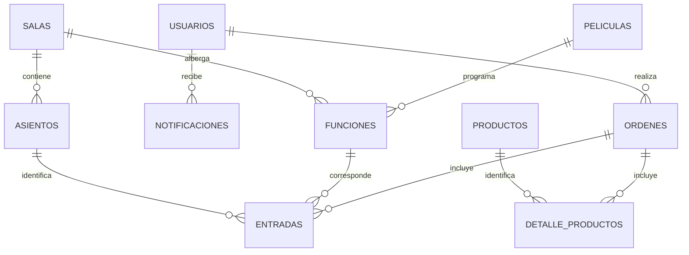

# CineVerse — Modelos de base de datos
Base auditada: PostgreSQL 17, 24/11/2026. Código c21f518. Las restricciones adicionales se aplicaron el 24/11/2026 en Supabase.

## Conceptual
Un usuario registra órdenes y recibe avisos. Una película se proyecta en funciones, cada una en una sala. Una sala contiene asientos. Una orden contiene entradas para una función y puede incluir productos. Cada entrada identifica la butaca, la función y el precio pagado. Cada detalle representa la cantidad de un producto y su precio histórico.

## Lógico
- usuarios(id PK, nombre, email UQ, password, rol, activo)
- peliculas(id PK, titulo, sinopsis, genero, duracion_minutos, clasificacion, fecha_estreno, imagen_url, estado)
- salas(id PK, nombre UQ, filas, columnas)
- asientos(id PK, fila, numero, sala_id FK, UQ(sala_id,fila,numero))
- funciones(id PK, pelicula_id FK, sala_id FK, fecha_hora, fecha_hora_fin, precio, cancelada)
- productos(id PK, nombre, categoria, precio, activo)
- ordenes(id PK, usuario_id FK, estado, total, fecha_creacion)
- entradas(id PK, orden_id FK, funcion_id FK, asiento_id FK, precio_unitario, UQ(funcion_id,asiento_id))
- detalle_productos(id PK, orden_id FK, producto_id FK, cantidad, precio_unitario)
- notificaciones(id PK, usuario_id FK, mensaje, leida, fecha_creacion)

Los precios históricos son hechos de la compra, no del catálogo. El total de la orden se almacena deliberadamente como dato derivado, calculado en el backend. La regla de una función por orden está implementada en el servicio, no como restricción SQL independiente.

## Físico
Consultar `migrations/ETAPA5_BASELINE_SOLO_BD_VACIA.sql`: reconstrucción del esquema observado, tipos, nulabilidad, checks e índices, sin filas. Los IDs son BIGINT autogenerados; nueve tablas con IDENTITY y notificaciones con BIGSERIAL. Los importes son NUMERIC(10,2). Las fechas de función y creación son TIMESTAMP WITHOUT TIME ZONE. Las relaciones tienen integridad referencial. No es un pg_dump exacto de permisos, extensiones y metadatos internos de Supabase.

Restricciones adicionales aplicadas: exclusión GiST por sala e intervalo [inicio,fin) para funciones no canceladas; cantidad 1–10 y unicidad orden/producto; índices de nombre/correo insensibles a mayúsculas. RLS permanece activo sin abrir la Data API. No se cambian datos existentes.
